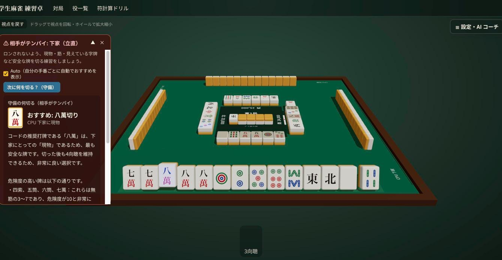
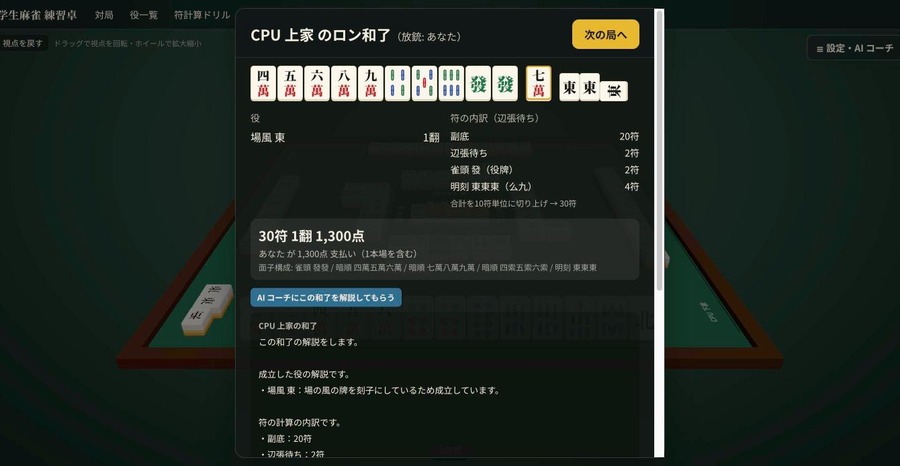
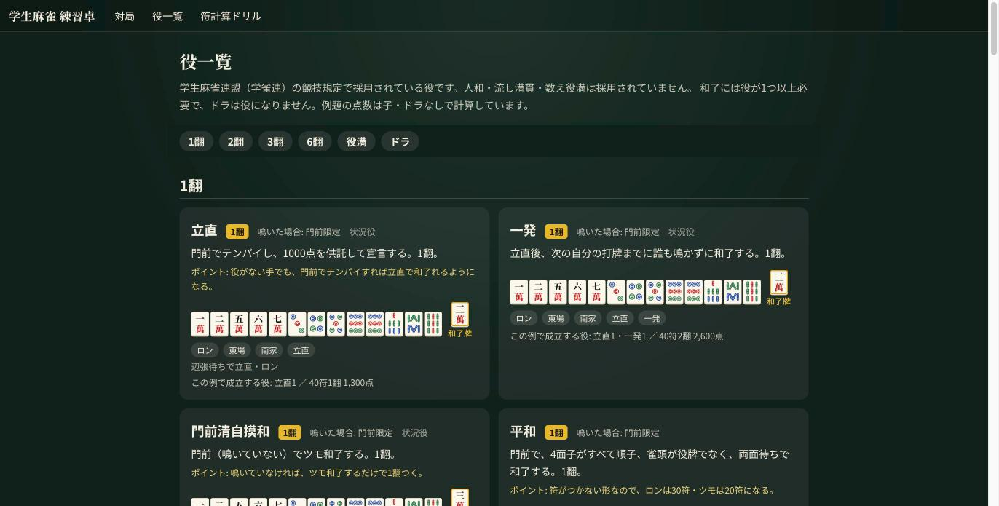
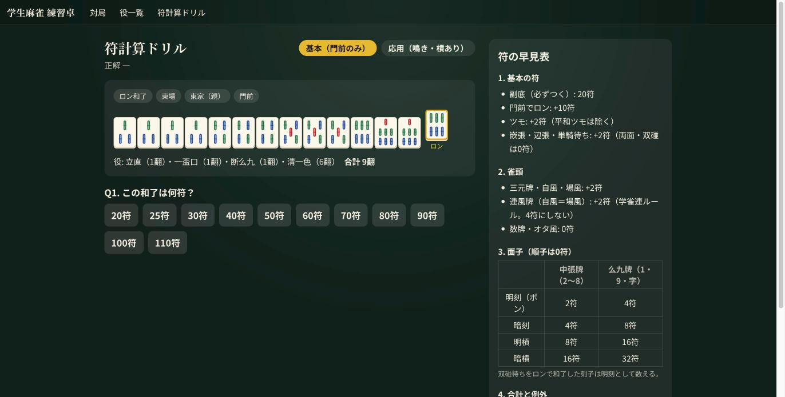

# 学生麻雀 練習卓

学生麻雀のルール（学生麻雀連盟の競技規定がベース）で、CPU 3人と東南戦を打ちながら麻雀を学べる Web ゲームです。
ローカルで動かす LLM（gemma4 など）を「AI コーチ」として使い、打牌の理由や和了の点数計算を解説させます。



> **注意**: 学生麻雀連盟とは関係のない、個人が作った非公式のアプリです。ルールは公開されている規定を参考に実装していますが、正確さは保証しません。

## できること

- **対局**: 人間1人 + CPU 3人の東南戦。2D 表示と 3D 表示（three.js）を切り替えられます
- **AI コーチ**（ローカル LLM）
  - 何切る: 先におすすめの牌だけを出し、「説明を聞きますか？」に「はい」と答えたときだけ理由を解説します
  - 河読み: 相手の河から、現物・筋・壁・染め手の気配などを整理します
  - 和了の解説: 成立した役、符の内訳、点数を説明します
- **守備練習**: 相手がテンパイすると（立直・ダマテン・副露のどれでも）知らせ、「次に何を切る？（守備）」で安全な牌をすすめます
  - Auto にすると、自分の手番ごとにおすすめを自動で表示し、その牌を手牌でハイライトします
  - CPU は役のある手で、ときどきダマテンにします
- **学習ページ**
  - 役一覧: 採用されている役と例題
  - 符計算ドリル: 和了形から符と点数を答える練習
- **学習用の表示**: 向聴数・待ち・フリテンのヒント、ツモ切りの牌を暗く表示、ポン・チー・カンで使う牌のハイライト

### スクリーンショット

| 和了の結果と AI コーチの解説 | 役一覧 |
| --- | --- |
|  |  |

| 符計算ドリル |
| --- |
|  |

### AI コーチの作り

LLM は麻雀の計算を間違えやすいので、計算はさせていません。
向聴数・受け入れ枚数・危険度・役・符・点数などはコードで計算し、その結果を「事実シート」にして LLM に渡します。LLM は事実シートを言い換えて説明するだけです。
画面の「AI に渡した事実」から、元になった計算結果をいつでも確認できます。

## ルール

学生麻雀連盟の競技規定（2024-03-25 改訂）を基本にしています。主な設定は次のとおりです。

| 項目 | 設定 |
| --- | --- |
| 対局 | 東南戦（西入なし） |
| 持ち点 / 返し | 25,000点持ち / 30,000点返し |
| 順位点 | +30 / +10 / −10 / −30（オカ +20 はトップ） |
| 赤ドラ | 各色1枚 |
| 喰いタン・後付け | あり |
| 途中流局 | なし |
| 切り上げ満貫 | あり（30符4翻・60符3翻） |
| 数え役満 | なし |
| 包（パオ） | 大三元・大四喜・四槓子 |
| 頭ハネ | あり |

規定に書かれていない細かい点（ノーテン立直を認めない、など）は、アプリ側で決めています。どれがアプリ側の判断かは `lib/mahjong/rules.ts` にコメントで書いてあります。

## 動かし方

### 必要なもの

- Node.js 20.9 以上（Node.js 24 で動作確認）
- AI コーチを使う場合: OpenAI 互換 API を持つローカル LLM サーバ（例: [llama.cpp](https://github.com/ggml-org/llama.cpp) の `llama-server`）

### セットアップ

```bash
npm install
cp .env.example .env.local   # AI コーチの接続先を変える場合だけ編集
npm run dev
```

ブラウザで <http://localhost:3000> を開きます。

### AI コーチ（ローカル LLM）の設定

`.env.local` で接続先を指定します。

| 変数 | 意味 | 既定値 |
| --- | --- | --- |
| `LLM_BASE_URL` | OpenAI 互換 API のベース URL | `http://127.0.0.1:8080/v1` |
| `LLM_MODEL` | モデル名（`llama-server` は1モデルだけなので何でもよい） | `local` |

gemma4 を `llama-server` で動かす例（モデルファイルは各自で入手してください）:

```bash
llama-server -m gemma-4-12b-it-Q4_K_M.gguf --port 8080
```

- アプリは思考モードを切るため、リクエストに `chat_template_kwargs: { enable_thinking: false }` を付けています。
- LLM サーバが動いていなくても、対局・おすすめの牌の表示・学習ページは使えます。
- モデルは同梱していません。使うモデルのライセンス・利用規約（Gemma の場合は Gemma Terms of Use）に従ってください。

> **公開サーバに置く場合の注意**: `/api/coach` は、受け取った事実シートを `LLM_BASE_URL` に中継します。ローカルで使う前提の作りで、認証やレート制限はありません。インターネットに公開すると、誰でもあなたの LLM サーバを使えてしまいます。

### コマンド

| コマンド | 内容 |
| --- | --- |
| `npm run dev` | 開発サーバを起動 |
| `npm run build` / `npm start` | 本番ビルド / 起動 |
| `npm test` | テスト（vitest） |
| `npm run typecheck` | 型チェック |
| `npm run lint` | lint（ESLint） |

## ディレクトリ構成

```
app/
  page.tsx               対局画面
  learn/yaku/            役一覧
  learn/fu/              符計算ドリル
  api/coach/route.ts     AI コーチ API（ローカル LLM への中継）
components/mahjong/
  MahjongGame.tsx        対局画面（操作・通知・設定）
  TileSvg.tsx            牌の絵（SVG）
  three/                 3D 卓（React Three Fiber）
  CoachPanel.tsx         AI コーチの表示
  ResultPanel.tsx        和了・流局・終局の結果
lib/mahjong/
  rules.ts               ルール設定
  shape.ts               向聴数・待ち・受け入れ
  evaluate.ts / score.ts 役・符・点数
  game/                  対局エンジン・CPU の思考
  coach/                 事実シートとプロンプト
  learn/                 役の例題・符計算ドリルの問題作成
  __tests__/             テスト
```

## 技術スタック

Next.js 16（App Router）/ React 19 / TypeScript / Tailwind CSS 4 / three.js + React Three Fiber + drei / vitest

## ライセンス

[MIT License](./LICENSE)

- 牌の絵（`components/mahjong/TileSvg.tsx`）とアイコンは、このリポジトリのために SVG で描いたものです。
- 依存パッケージは、それぞれのライセンスに従います（`node_modules` はリポジトリに含めていません）。
- フォント（Noto Sans JP / Noto Serif JP）は `next/font` がビルド時に Google Fonts から取得します。SIL Open Font License です。
